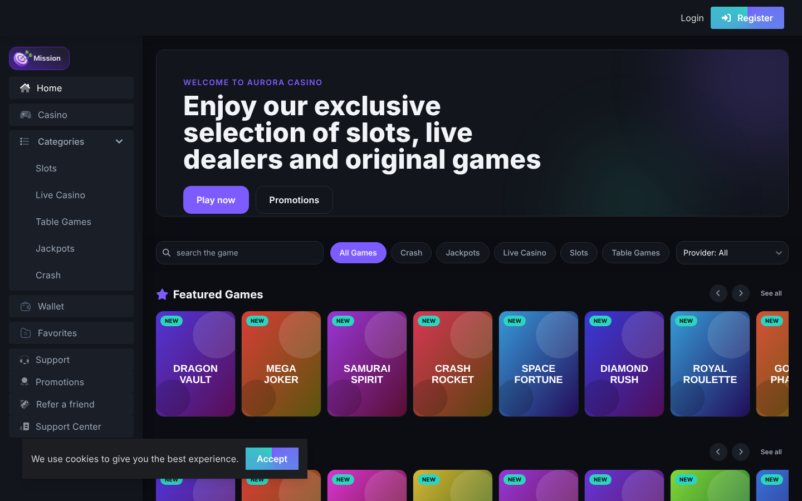
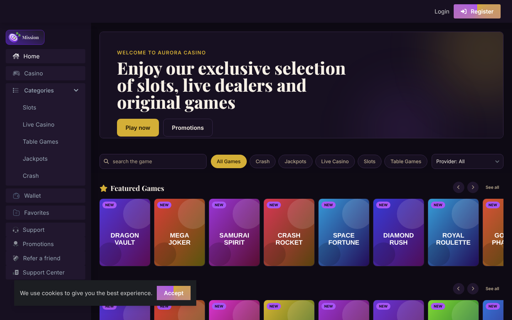
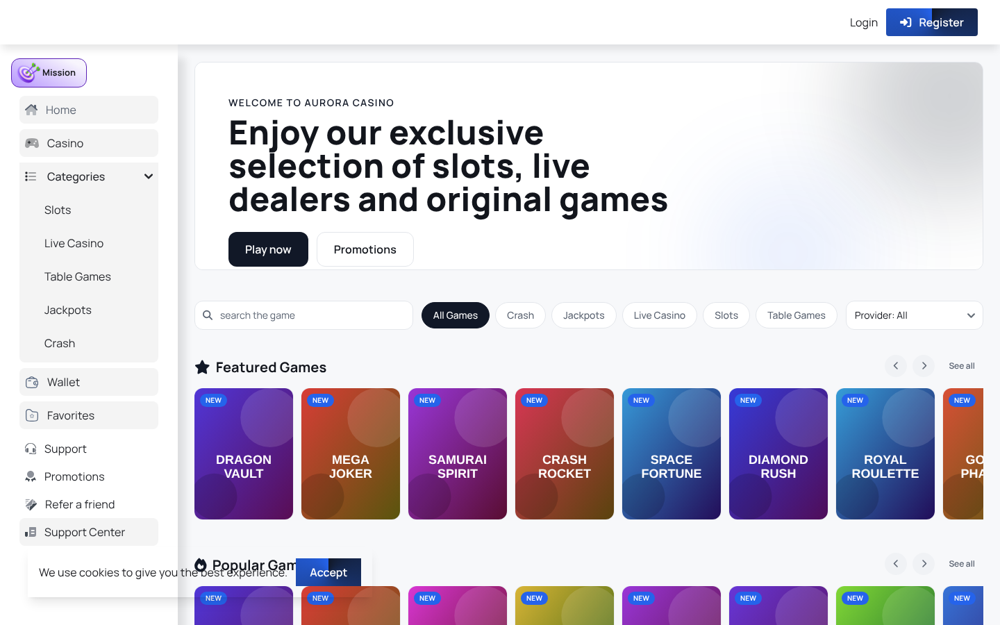
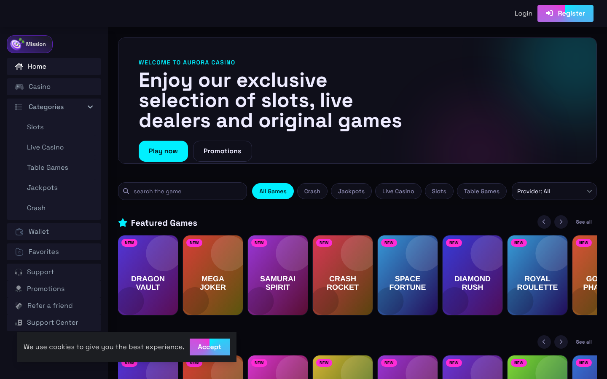

# Themes, Design System and Lobby

_Phase 6. Code: `config/themes.php`, `app/Core/Theming`, `resources/js/Components/DS`, `resources/js/Pages/Lobby`._

| Obsidian (dark premium) | Royal (luxury) |
|---|---|
|  |  |
| **Minimal (clean modern, light)** | **Neon (modern gaming)** |
|  |  |

The filtered lobby and the mobile layout are in `docs/screenshots/`. The screenshots use demo data and generated covers.

## Theme system
* A theme is a set of **design tokens**: `bg`, `surface`, `surface-2`, `border`, `text`, `muted`, `primary`, `primary-contrast`, `accent`, `success`, `warning`, `danger`, plus radius, body/heading font (from an allowlist) and colour scheme (`dark`/`light`).
* Each casino picks a theme in **Admin → Modulos → Theme** (with a live preview) and can override `primary`, `accent`, radius and font.
  * Overrides are validated (strict `#RRGGBB`, radius 0–28 px, allowlisted fonts) and anything else is dropped, so theme settings cannot inject CSS.
  * When `primary` is overridden, `primary-contrast` is recomputed for WCAG contrast.
* `<html>` gets `data-theme`, and the `dark` or `light` class from the theme's scheme. A visitor's explicit light/dark toggle still wins.
* **Tokens are emitted as CSS custom properties** (`--vp-*`, plus `--vp-*-rgb` triplets for alpha). Tailwind exposes them as the `vp` palette (`bg-vp-surface`, `text-vp-primary/80`, `rounded-vp`, `font-vp-heading`).
* **Existing pages adopt the theme:** it also drives the legacy `--ci-*` and layout-chrome variables (nav, sidebar, cards, inputs).
* **Legacy mode (no theme chosen):** the casino's existing custom colours are used exactly as before. The new components get tokens derived from those colours. This is what an upgraded tenant #1 sees until an admin picks a theme; new tenants start on Obsidian.
* Tailwind now uses `darkMode: 'class'`, so the scheme follows the theme instead of the visitor's OS. The layout always declared `class="dark"`, but Tailwind ignored it.

## Design-system components (`resources/js/Components/DS`)
`VpButton`, `VpChip`, `VpSectionHeader`, `VpGameCard` (lazy image, name fallback, badges, keyboard-focusable play overlay, skeleton), `VpGameRail` (scroll-snap rail with arrows and skeletons), `VpResponsibleGaming`.

All of them use only `vp` tokens, so they work in every theme.

## Lobby (new homepage, `/`)
* **Hero:** the casino's carousel banners, or a neutral welcome. Auto-advance pauses when the visitor prefers reduced motion.
* **Sticky filter bar:** search (debounced), category chips and a provider select. Filters live in the URL (`?q=&category=&provider=&section=`), so a filtered lobby can be shared.
* **Default view:** Featured / Popular / New releases rails, the casino's "home" promo tiles and a provider grid.
* **Filtered and "See all" view:** a grid with a result count, "Load more" and an empty state. Stale responses are discarded when filters change quickly.
* **Responsible-gaming notice** (18+, play responsibly).
* The previous homepage remains at `/classic` during the transition.

API (`App\Http\Controllers\Api\Lobby\LobbyController`):
* `GET /api/lobby/games?section=featured|popular|new|all&category=&provider=&q=&per_page=&page=`: normalized cards with `id`, `name`, `code`, `thumbnail`, `provider`, `categories`, `is_featured`, `is_new`, `has_demo` and `rtp`.
  * Thumbnails are absolute URLs whether the cover is a URL or a storage path.
  * `per_page` is at most 48, and search wildcards are escaped.
  * The model's per-game appends (several queries each) are skipped.
* `GET /api/lobby/providers` and `GET /api/lobby/categories`.

## Fixed during this phase
* The **whole SPA failed to load whenever `www.gstatic.com` was unreachable**, because `DataPage` imported Firebase from Google's CDN as a static ES module and the router loaded it eagerly. The route is now lazy, so a failure only affects that page.
  * The Firebase configuration also points at a third party's project (`footballapi-77676`, API key in the source). See `SECURITY_AUDIT.md` #28.
* **Fabricated activity removed:**
  * The sports "bets feed" showed hardcoded rows with invented users and stakes.
  * The affiliate page listed invented "rules", including another brand's wallet ("CREDK") and checks the code doesn't perform.
* **Inline layout config was printed with raw `json_encode` inside `` stored in any layout field could break out. It now uses `@json`, which escapes it.
* **Four malformed CSS variable declarations** in the legacy layout (missing `:`), so those colours never applied.
* **The deposit widget's "maximum deposit" message showed the minimum.**
* **Remaining Portuguese UI strings and hardcoded `R$` amounts:** the strings are translated, and amounts are formatted with `Intl.NumberFormat` (`resources/js/Services/money.js`) in the casino's currency.

## Not done yet (tracked)
* **Not yet rebuilt with the design system:** wallet, deposit and withdraw flows, profile, VIP, promotions and the auth modals. They're themed through the legacy variable mapping. The redesign of these screens continues alongside Phase 8 (player account, responsible-gaming tools).
* **Legal pages** (`/terms/*`) are still Portuguese template text. Legal terms must come from each operator for its jurisdiction and will be tenant-managed content (Phase 8).
* **Sports pages** depend on the third-party Firebase feed. They need a licensed odds/data provider (Phase 7).
